

  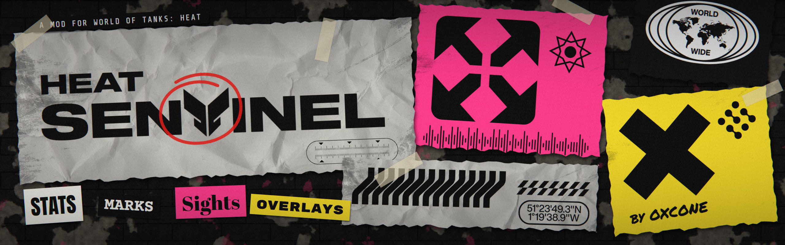

  <b>English</b> | <a href="README.ru.md">Русский</a>

# HEAT Sentinel

HEAT Sentinel is a mod for **World of Tanks: HEAT** that runs next to the game. It records every battle you play and turns it into stats, profiles, rivalries and Marks of Excellence. It puts a real map under your radar, gives you a tactics board for planning rounds with your team, and adds team alerts, custom sights and your own colours to the game's interface. In-game and stream overlays show all of it live.

> WoT: HEAT Sentinel is an unofficial statistics gathering app. It is not affiliated with, endorsed by, or sponsored by Wargaming Group Limited. All in-game assets and trademarks belong to their respective owners.

## Download

<!-- RELEASE-EN:START -->

**Latest release:** [v3.1.0](https://github.com/OxCone1/HEAT-Sentinel/releases/tag/v3.1.0) -- published 2026-10-28

| File | Size | VirusTotal report |
|------|------|------|
| [`HEAT.Sentinel_3.1.0_x64-setup.exe`](https://github.com/OxCone1/HEAT-Sentinel/releases/download/v3.1.0/HEAT.Sentinel_3.1.0_x64-setup.exe) (app installer) | 158.4 MB | [View scan](https://www.virustotal.com/gui/file/69a7683fd413b1c4d82df9c05d87c35a69cdfa65fe63424cee2b65775b8a6f01) |
| `heat-capture.exe` (capture/watcher engine, bundled inside the installer) | 43.0 MB | [View scan](https://www.virustotal.com/gui/file/d8cb4890f96e7539813e826f208b3d12047fdca63d0d00fcb0fe14d6a1c23f08) |
<!-- RELEASE-EN:END -->

Every release is built by GitHub Actions and scanned on VirusTotal, and updates are signed. Windows SmartScreen will warn about the installer because it is not code-signed: "More info", then "Run anyway". [Why, and how to check a build yourself](docs/security-and-privacy.md).

  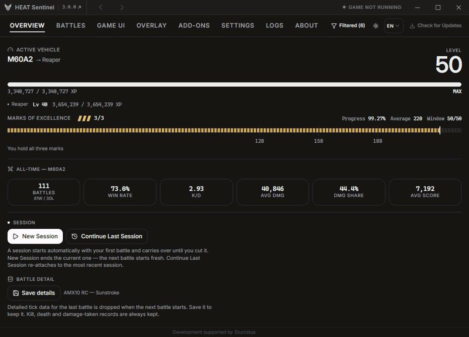

---

## Features

### Tactics Board

Plan rounds on the real maps. Place units, draw timed routes, arrows and areas, add notes, and play the round back on a timeline phase by phase. Multi-floor maps, teams and rosters, a strategy library, sharing by file, code or link, a presentation mode and image export. Built with competitive play and tournaments in mind. [More](docs/add-ons.md#tactics-board)

### A real map on your radar

The actual map layout is drawn under the in-game radar and follows your floor: drive into a bunker and the radar shows that bunker's own layout. Every dot gets its class icon, with an arrow when a vehicle is above or below you. [More](docs/game-ui.md#minimap)

### Team alerts

For random teammates who have no microphone. Ask for cover and see who is coming and how far out they are, answer a teammate's call for help, and get a warning when a teammate is about to ram you off your position. Platoon range lines show how far each platoon mate is. [More](docs/game-ui.md#notifications)

### Battle stats that remember everything

Every battle is recorded on its own: result, damage, kills, map, mode, tank, agent and the loadout you took in, plus everyone else in the match.

- **Overview, Battle list, Trends and Session** views, with breakdowns by tank, agent, map and mode. Open any tank for its full report, including its peak win rate and damage.
- **Profiles** for every player you have met: win rate with and against you, modes, platoon mates, progression and what they did in each battle. Click any nickname in the app.
- **1v1 rivals**: your running score against every opponent, who your best and worst tanks are against them, and the full encounter log.
- **Platoon** stats for the people you play with, **XP** for every tank and agent, and **Loadouts** read from your account, including tanks you have never taken out.
- **Filters** to leave chosen modes, maps or tank-swap battles out of every stat page at once, and sessions you can merge or split.

### Marks of Excellence

Up to three marks per tank, earned by your damage per minute against other players on the same tank and mode, over your last 50 battles. See what the next mark needs, which battle drops out next, and a live projection during the fight. Balanced in the open through calibration packs in this repository, with a [public marks page](https://oxcone1.github.io/HEAT-Sentinel/marks/). [More](docs/marks-of-excellence.md)

### Custom sights

Reticle packs that replace your crosshair, reload, magazine, overheat gauge and second gun, from a public catalogue, for every gun in the game. Design your own in [Sight Forge](https://oxcone1.github.io/HEAT-Sentinel/forge/) and preview it live on your battle HUD as you draw. [More](docs/game-ui.md#sight-custom-reticles)

### Your game, your interface

- **Battle HUD**: hide any part of the HUD, radar, nameplates, kill feed, markers, scoreboard, map, deploy and hangar screens, and keep it as presets.
- **Colors**: a COLORS tab inside the game's own Settings, with colour-blind profiles and presets you can share as a code.
- **Tags**: mark the players you meet (Dangerous, Low skill, Friend, Hmmm, Hunt down, Charge) and see the icons on the scoreboard and above their tanks.
- **Sentinel Friends**: a friends tab in the hangar with online status and squad invites.
- **QOL**: platoon auto-ready and auto-search, labels for every platoon in the match, and a post-battle fast skip straight to the hangar.

[More about Game UI](docs/game-ui.md)

### Overlays

An **in-game overlay** with stat tiles, ability gauges, team composition by remaining health, and Marks of Excellence, each shown only when it matters (while aiming, during a round). A **stream overlay** for OBS with a click-to-add palette that you edit live in your browser while you stream. [More](docs/overlays.md)

### Add-ons

- **Replays** (beta): a replay library the game cannot clean out, and a free camera with gunner view, outlines through walls, shot paths, a tank panel and rewind.
- **HEAT Snap**: clips a streamer's Twitch broadcast when you destroy them, or they destroy you.
- **HEAT Sabotage**: for streamers, viewers spend channel points to switch off parts of your HUD.

[More about add-ons](docs/add-ons.md)

### And also

- **Builds**: named builds, a Build Composer that enforces the energy and slot rules, one-click apply, and sharing as a code or a `sentinel://` link. [More](docs/build-links.md)
- **Discord Rich Presence**: your profile shows the hangar, the queue, or the tank, map and mode you are fighting in.
- **The app itself**: twelve languages, interface scale from 60% to 150%, two looks, and a built-in updater with release notes.

---

## Gallery

<table>
  <tr>
    <td width="33%">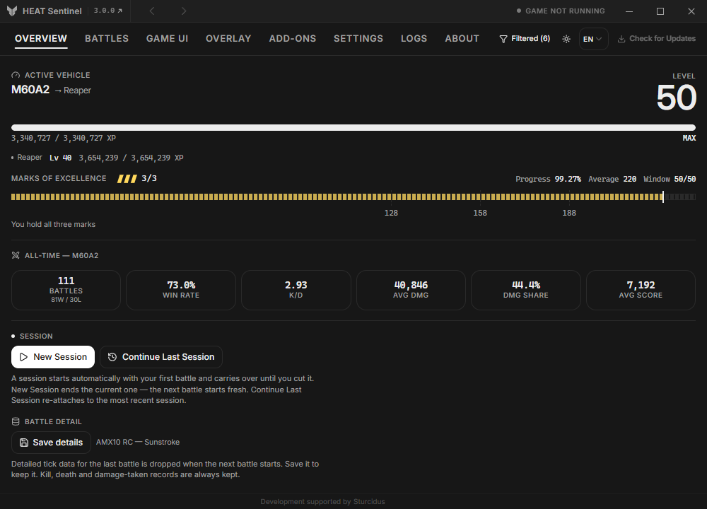 Overview with the live match card</td>
    <td width="33%">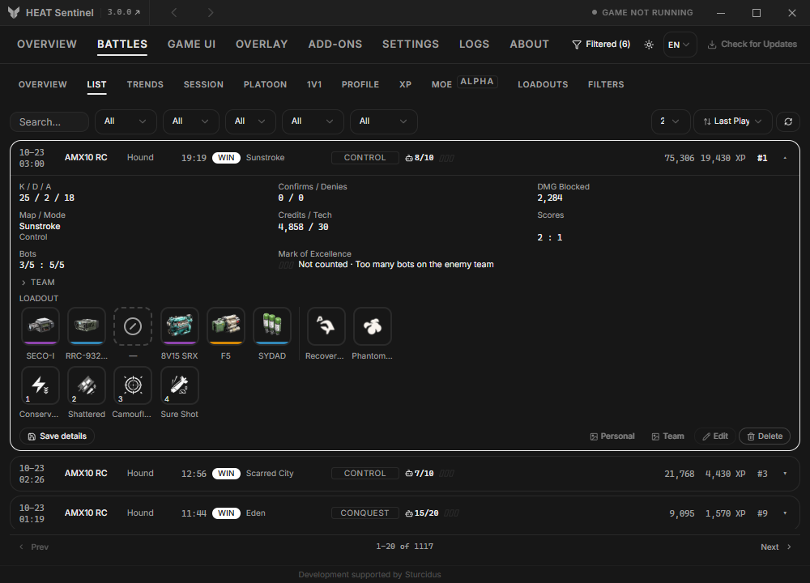 Battle list</td>
    <td width="33%">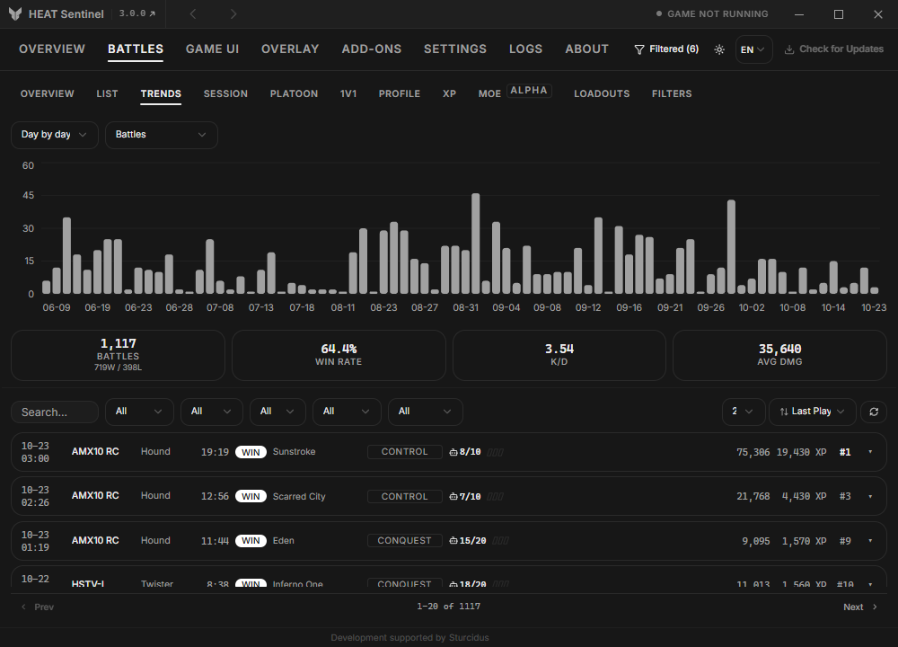 Trends</td>
  </tr>
  <tr>
    <td>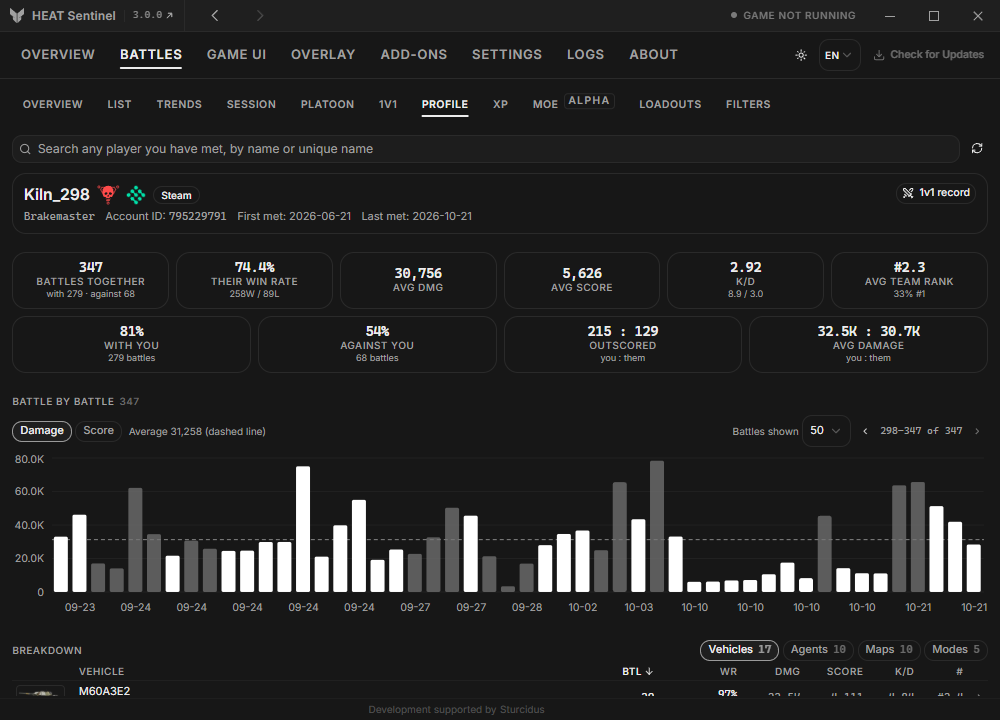 Player profile</td>
    <td>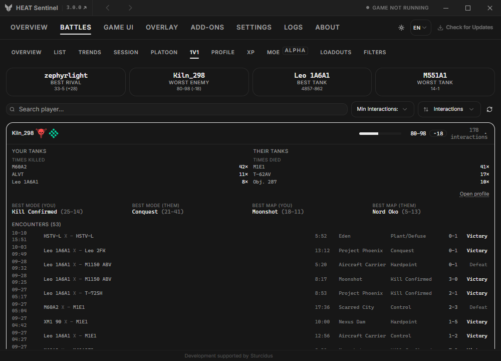 1v1 rivals</td>
    <td>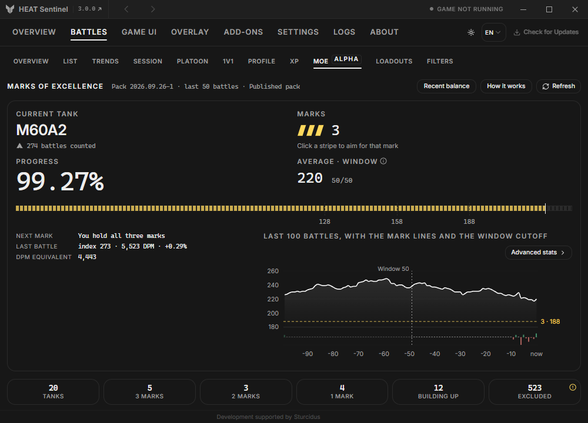 Marks of Excellence</td>
  </tr>
  <tr>
    <td>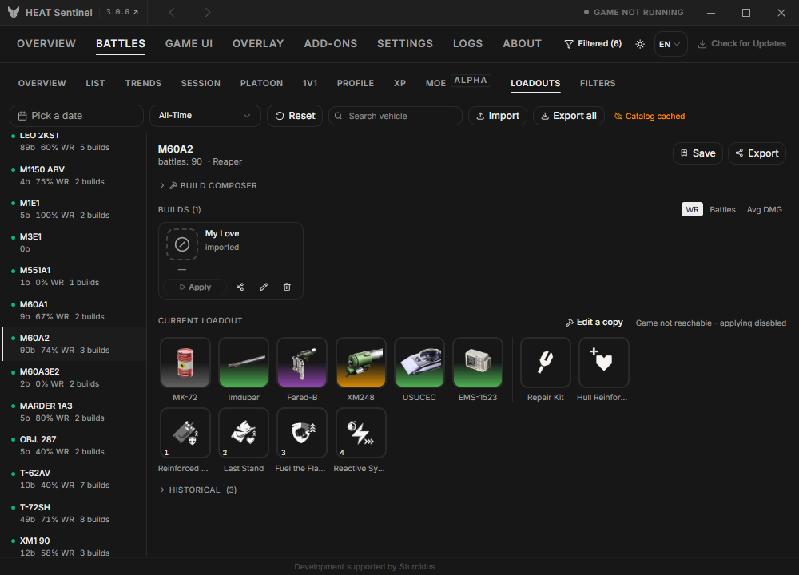 Loadouts</td>
    <td>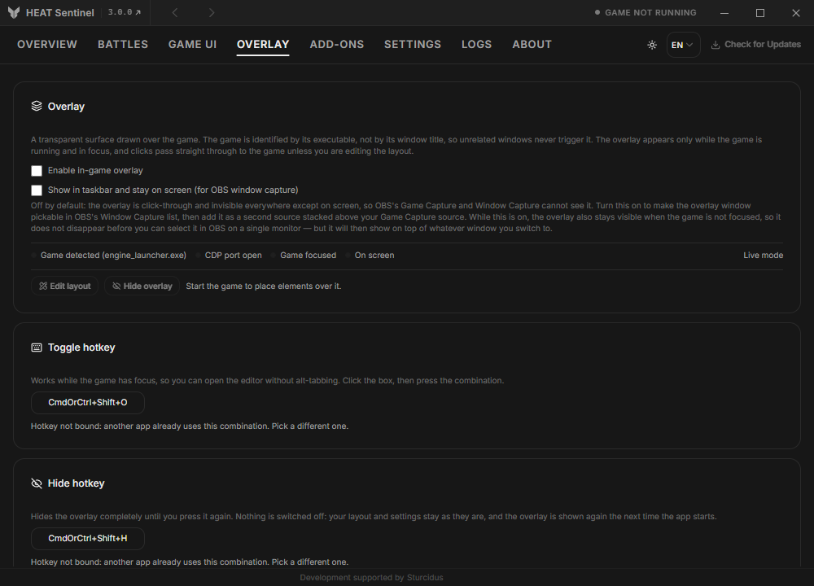 In-game overlay</td>
    <td>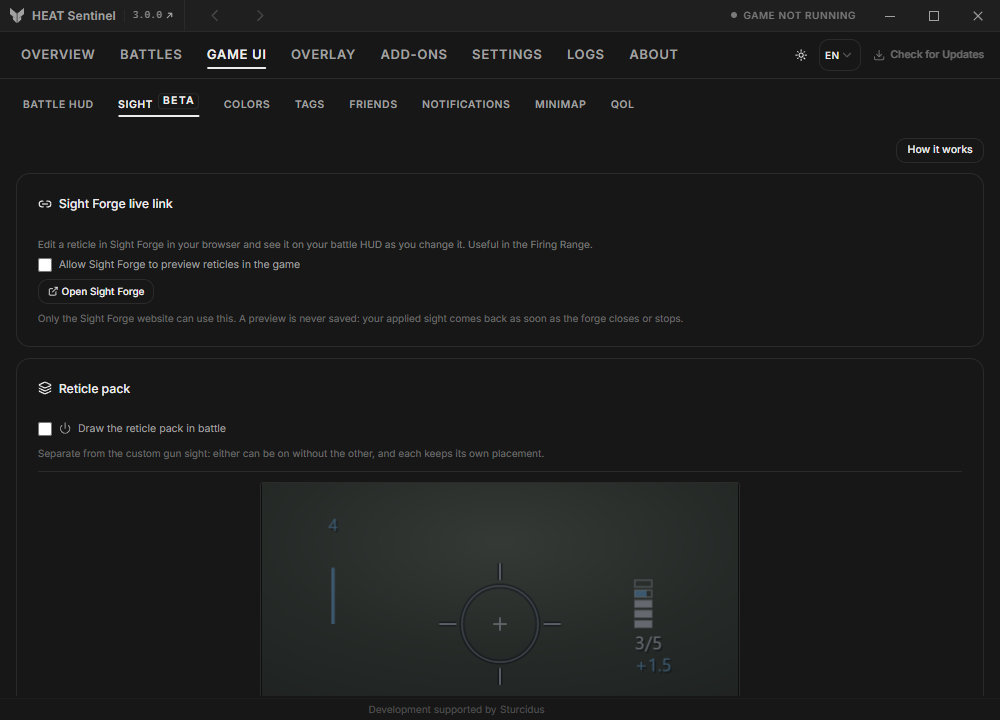 Sight packs</td>
  </tr>
  <tr>
    <td>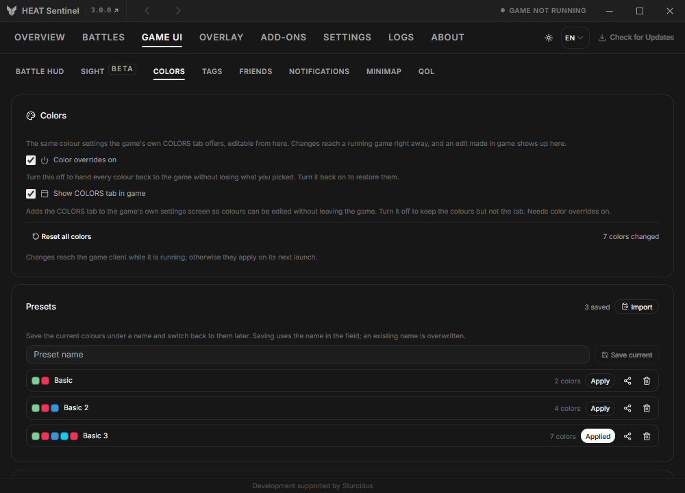 Colors</td>
    <td>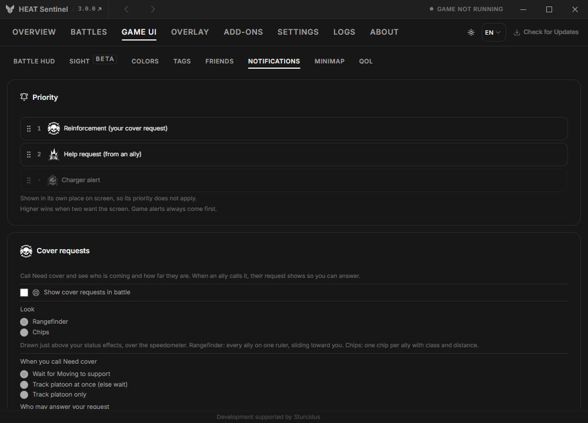 Team alerts</td>
    <td>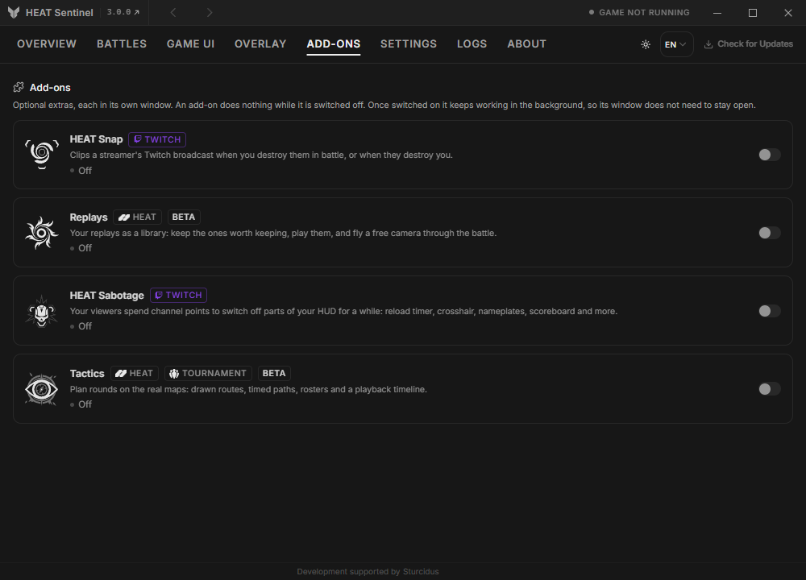 Add-ons</td>
  </tr>
</table>

---

## Getting Started

1. Download the installer above and run it.
2. Launch HEAT Sentinel and point it at your game folder. If the game was already running, restart it once.
3. Play. Battles are recorded on their own while the app is open, and your tanks, XP and loadouts are read the first time you reach the hangar. There is nothing to calibrate.

Sessions start with your first battle and carry over until you start a new one. Your history stays on your PC and survives updates and reinstalls. [Full guide: installation, sessions and moving your data to a new PC](docs/installation.md)

## Documentation

| Guide | What is in it |
|-------|---------------|
| [Installation and first launch](docs/installation.md) | Install steps, sessions, where your data lives, moving to a new PC, updating |
| [Overlays](docs/overlays.md) | The in-game overlay, the stream overlay editor, OBS setup step by step |
| [Marks of Excellence](docs/marks-of-excellence.md) | How marks are earned and kept, calibration packs, the public marks page |
| [Game UI](docs/game-ui.md) | Battle HUD, Sight, Colors, Tags, Friends, Notifications, Minimap, QOL |
| [Add-ons](docs/add-ons.md) | Tactics Board, Replays, HEAT Snap, HEAT Sabotage |
| [Build links](docs/build-links.md) | Sharing builds, the Build Composer, and [integrating a planner site](docs/build-share-codes.md) |
| [How it reads the game](docs/how-it-reads-the-game.md) | The main mode, the Legacy OCR reserve, calibrations and patterns |
| [Security and privacy](docs/security-and-privacy.md) | VirusTotal, SmartScreen, what stays local, what goes over the network ([Privacy Policy](PRIVACY.md)) |
| [Troubleshooting](docs/troubleshooting.md) | Failed updates, closing every instance, sending logs |
| [Contributing](docs/contributing.md) | Reticles, translations, game data, marks feedback, calibrations |

The app itself is closed source. This repository is its public home: releases, documentation, the reticle catalogue, Marks of Excellence calibration packs, map packs, localisation data, the build-link catalogue and community contributions.

---

## Fair Play and Disclaimer

- **Unofficial Project**: WoT: HEAT Sentinel is an unofficial statistics gathering app. It is not affiliated with, endorsed by, or sponsored by Wargaming Group Limited. All in-game assets and trademarks belong to their respective owners.
- **Use at Your Own Risk**: The app is provided "as is", without warranties of any kind. While every effort goes into stability and safety, you use it at your own risk. Always be cautious with executables downloaded from the internet, and use the VirusTotal links provided with every release.
- **Fair Play by Design**: HEAT Sentinel only reads information that is already visible to you during legitimate play. Its interface features change how the game's own interface looks, never what it knows. It does not and will not:
  - expose or exploit game information that is not normally available to a player, or anything that could grant an unfair advantage over others;
  - modify the game's executables or alter its memory or processes;
  - automate gameplay: no auto-aim, no auto-fire, no scripted decisions, nothing that replaces human input in battle;
  - bypass or interfere with any anti-cheat, integrity or detection mechanism of the game.
- **What You Must Not Do**: by using HEAT Sentinel you agree not to:
  - use it, or attempt to modify it, to extract information not exposed through legitimate gameplay;
  - distribute modified versions of it that enable any of the behavior listed above;
  - bundle or advertise it together with tools whose purpose is cheating, hacking or exploiting the game;
  - sell or otherwise monetize modifications that violate these rules;
  - present it as affiliated with, endorsed by, or approved by Wargaming or World of Tanks: HEAT.
- **Support**: this is a free project developed in spare time. Bugs get fixed and ideas get considered as time allows; patience is appreciated, and contributions are welcome.

## Roadmap

- **More statistics**: deeper aggregates, richer per-vehicle / per-agent / per-map breakdowns, and more of it as overlay widgets
- **More team tools**: more ways to put the ping wheel to work
- **More reticles and in-game designs**, together with the community
- **Marks of Excellence**: regular rebalancing as the game and its player base change
- **Opt-in online features**: live combat sharing between platooned HEAT Sentinel players, and a public web portal for the battles you choose to upload. Both strictly opt-in, and the privacy policy is updated before any of it reaches a release
- **Linux**: builds for players who run the game through Proton

## Acknowledgements

HEAT Sentinel would not be what it is today without the community members who tested early builds, reported bugs, gave feedback and helped shape its direction: AET9RNAL, sneakyConcept, Ustitsa_13, iSeNtYi, SINEWAVE, \_VEN0M, \_\_\_Oz\_\_\_, 99999999999999, lullabyvlr, T_A_N_K_I_S_T_E_G_O_R, Animaluos, Yzhe_Nikto, Sturcidus, Faustous_, Montainary, venom_OLEG_slabitelnoe and others.

**Special thanks to: odmarker228, Sturcidus, venom_OLEG_slabitelnoe, sneakyConcept**

## Need Help?

- **Open an issue** on the [Issues page](https://github.com/OxCone1/HEAT-Sentinel/issues) with steps to reproduce.
- **Join the Discord server**: [discord.gg/AjfcuhDDw5](https://discord.gg/AjfcuhDDw5) and ask there directly.
